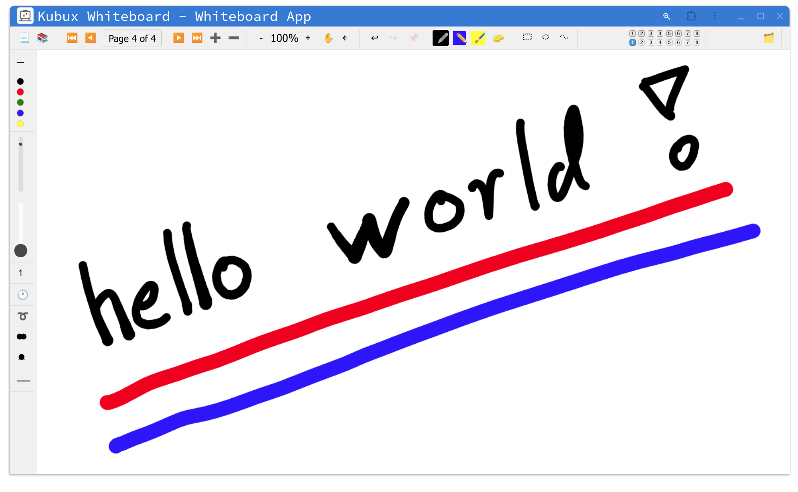

# Kubux Whiteboard Server

A real-time collaborative whiteboard application designed for mathematics education and collaboration. This project provides a WebSocket-based server and browser client that enables multiple users draw on a shared canvas in real-time. The idea is that you will run your own whiteboard server on your home lab.



## Features

- **Real-time collaboration** - Multiple users can simultaneously work on the same whiteboard
- **Multi-page support** - Create, delete, and reorder pages in a whiteboard
- **Page Overview Mode** - Grid of page thumbnails with drag-and-drop reordering, batch delete, and multi-page PDF export
- **Spectator mode** - You can send invites that enable viewing (including navigation) but not editing
- **Pen slots** - Six pens, each remembering its own shape, color, width, opacity, and stroke style, plus an eraser
- **Shape tools** - Draw freehand curves, rectangles, circles, and horizontal, vertical, or straight lines
- **Advanced stroke controls** - Cap style (round/butt/square), join style (round/bevel/miter), and dash patterns (solid/dashed/dotted/longdash/dashdot)
- **Pressure sensitivity** - Adjustable sensitivity levels (0-9) for variable-width strokes
- **Path modes** - Open paths, closed paths, and filled shapes
- **Selection tools** - Rectangle, lasso, and stroke-based selection with cut/copy/paste
- **Interactive paste** - Paste with affine transform controls (move, rotate, scale, shear), plus multi-paste modes that place 2–36 copies evenly along an open path, a straight, horizontal, or vertical line, around a circle, or in a rectangular grid
- **Canvas formats** - Optional page format presets (A4, Letter, Legal, each portrait or landscape; 16:9, 16:10, 4:3, 3:2, 2:1; custom) with fit-width/fit-height zoom
- **Layer system** - Organize content across 8 separate layers with visibility control
- **PDF export** - Export the current page from the toolbar, or selected pages or the entire board from the overview, as vector PDFs
- **Undo/redo** - Full history tracking with undo/redo capability
- **Boards view** - A full-window page for the current board (its links, going to another board) and, after logging in, your boards
- **Board manager** - Your boards as an expandable folder tree (from paths like `teaching/algebra/week1`), with a filter; create, open, rename and move boards and folders, copy their links, change your credential
- **Timer** - A per-pen switch: strokes drawn with that pen are erased automatically after 3 seconds, for temporary annotations during presentations
- **Page caching** - Client-side LRU cache for fast page switching with server hash verification
- **Progressive Web App (PWA)** - Install as a standalone app on tablets and mobile devices

## Installation

### Prerequisites

- Nix package manager (recommended) - Provides Node.js and all dependencies automatically
- Alternatively: Node.js (v18 or higher; the server uses `structuredClone` and `Object.hasOwn`) and npm

### Setup

1. Clone the repository:
   ```bash
   git clone https://github.com/yourusername/kubux-whiteboard-server.git
   cd kubux-whiteboard-server
   ```

2. Create required directories:
   ```bash
   mkdir -p data conf logs
   ```

3. Set up users (for creating and managing boards):
   ```bash
   # Create a user entry: a new id, the login, and the hash of the credential
   ./passwd_hash alice alices-secret-credential
   ```
   The output is one entry such as
   ```json
   {
     "id": "08166a51-4c8b-4cd8-b441-7a43b28ffef5",
     "login": "alice",
     "hash": "5d90cd98...salt...:8c1fce6c...hash..."
   }
   ```
   `conf/users.json` is a list of such entries:
   ```json
   [ { "id": "...", "login": "alice", "hash": "..." }, { "id": "...", "login": "bob", "hash": "..." } ]
   ```
   The id is what boards record as their owner, so it must never change once the user owns boards. Users change their credential themselves in the board manager, which rewrites `conf/users.json`; for that, `conf/` has to be writable by the server. The server reads `conf/users.json` only at startup; if it is malformed, the error is logged and nobody can log in.

   **Upgrading from `conf/passwd.json`:** that file is no longer read. Create `conf/users.json` as above. Boards created before boards had owners appear in nobody's board list; give them an owner and a path with the server stopped, in the server's working directory:
   ```bash
   ./assign_board <board-uuid> alice "archive/old-lecture"
   ```
   
   **Security Note:** The password hashing uses **scrypt**, a memory-hard key derivation function that is highly resistant to:
   - Rainbow table attacks (each password gets a unique random salt)
   - Brute-force attacks (computationally expensive to compute)
   - Hardware-accelerated attacks (memory-hard design)
   
   The hash format is `salt:hash` where both parts are hex-encoded.

4. Install dependencies (if using Nix):
   ```bash
   nix develop
   ```
   
   Or with npm directly:
   ```bash
   npm install
   ```

## Running the Server

The Kubux Whiteboard Server supports two modes of operation:

### Mode 1: Direct Mode (Local/Development)

This mode allows the server to listen on a specified port and serve the application directly without a reverse proxy. Perfect for local testing or ad-hoc usage.

```bash
KUBUX_WHITEBOARD_URL=http://localhost:8080 npm start
```

You can specify any port:
```bash
# Run on port 3000
KUBUX_WHITEBOARD_URL=http://localhost:3000 npm start
```

**Use case:** 
- Local testing and development
- If the specified port is exposed (not blocked by a firewall) and your computer is accessible from the outside, you can use this mode to create an ad-hoc whiteboard session without a dedicated server


**Access:** Open your browser to the URL specified in `KUBUX_WHITEBOARD_URL` with a query parameter, e.g. `http://localhost:8080/?login=<your_login>` to log in and manage your boards, or `http://localhost:8080/?board=<board-uuid>` to open a board. The bare URL without a `board`, `passwd`, `login`, or `credential` parameter returns 404.


### Mode 2: Docker with Reverse Proxy (Production)

For production deployments, the repository includes a Dockerfile and docker-compose.yml template for running with nginx-proxy and automatic SSL certificate management via Let's Encrypt.

#### Prerequisites
- Docker and Docker Compose installed
- A domain name pointing to your server
- nginx-proxy setup (included in docker-compose.yml)

#### Setup

1. **Integrate nginx-proxy and the whiteboard server into your docker-compose.yml**
   
   A minimal `docker-compose.yml` file (just the reverse proxy and the whiteboard server) is included in the distribution.  Replace the following placeholders:
   
   ```yaml
   # In the proxy service:
   - <your_nginx_dir>         # Directory for nginx-proxy data (e.g., /home/user/nginx-proxy)
   - <your_mail>              # Your email for Let's Encrypt notifications
   
   # In the whiteboard service:
   - <your_whiteboard_domain> # Your domain (e.g., whiteboard.example.com)
   - <app-dir>                # The repository checkout, containing conf/, data/, logs/ and node_modules/
   ```

   Also adjust `build.context` (the path to the repository, relative to the compose file), `container_name`, and `user` (the owner of `<app-dir>` on the host, `stat -c %u:%g <app-dir>`); the template has values from the author's setup. The checkout is mounted read-only, with only `conf/` (for credential changes), `data/` and `logs/` writable.

2. **Create required directories on host**
   
   ```bash
   # Create nginx-proxy directories
   mkdir -p <your_nginx_dir>/{ssl,var/log/{nullmailer,unattended-upgrades,dockergen,dnsmasq,letsencrypt,nginx}}
   ```
   
3. **Start docker-compose**
   The docker-compose file builds the container for the whiteboard server directly from the Dockerfile. The Dockerfile copies nothing into the image; it relies on the somewhat hacky trick of mounting the development directory directly into the container, so run `npm install` in the checkout first. If you have set up the data, logs, and conf directories and the password file for local testing, they can be directly reused for deployment.

4. **Support for PWA**
   The `start_url` in `manifest.json` is the page an installed app opens. The shipped value is a placeholder (`board=00000000-0000-0000-0000-000000000000`) that the server rejects, because it is not a version-4 UUID; replace it with the URL of a board on your server. When the client points the browser to a shared URL, they should be offered the option to install the progressive web app. The advantage on a tablet is that the browser interface is removed in the web app which enlarges the available board space.
   

#### How it works

The Docker deployment uses a multi-container setup:

- **nginx-proxy container**: 
  - Handles SSL termination with Let's Encrypt
  - Routes traffic to the whiteboard container
  - Listens on ports 80 (HTTP) and 443 (HTTPS)

- **whiteboard container**:
  - Runs the Node.js whiteboard server
  - Exposes port 80 internally (no external port mapping)
  - Connects to proxy via Docker network
  - Environment variables:
    - `VIRTUAL_HOST`: Your domain name
    - `VIRTUAL_PORT`: 80 (tells nginx-proxy which internal port to use)
    - `LETSENCRYPT_HOST`: Domain for SSL certificate

**Traffic Flow:**
1. Client → HTTPS:443 (nginx-proxy)
2. nginx-proxy → HTTP:80 (whiteboard container)
3. Client connects via WSS (WebSocket Secure) through nginx-proxy

**Access:** https://your-whiteboard-domain/?login=<your_login>

#### Managing the deployment

```bash
# View logs
docker-compose logs -f whiteboard

# Restart the whiteboard service
docker-compose restart whiteboard

# Stop all services
docker-compose down

# Rebuild after code changes
docker-compose up -d --build
```

## Usage

### Creating a New Whiteboard
    Point your browser at: "https://your-whiteboard-domain/?login=<your_login>"

The boards view opens; log in with your credential (or add `&credential=<your_credential>` to the URL to log in directly). The client does not remember the credential: it is kept only while the page is open, so let your browser's password manager fill it in. "Log out" in the top bar makes the page forget login and credential at once. Type a path into "Path of a new board" and press "New Board", or use a folder's "new board" button to create a board in that folder; a name with `/` in it creates subfolders. The new board opens in the same page, and the "Current Board" section's "Copy Edit Link" and "Copy View Link" hand out its links. The URL contains a password. Share the URL including the password with collaborators and leave out the password when sharing with spectators (the password is needed for editing not for viewing).

### Managing Boards

Click the folder icon (🗂️) to open the boards view; Close or Escape returns to the board. The view has three parts, one above the other:

- **Top bar** - your login, "Change credential", "Log out" and "Close".
- **Current Board** - the board's path (if it is one of yours; the links do not contain it), "Copy View Link" / "Copy Edit Link", and "Go to Board" by link or board ID.
- **My Boards** - after logging in, your boards as a tree: a board's path, such as `teaching/algebra/week1`, puts it into the folder `teaching/algebra`. Folders are not created separately; a folder exists while a board lies in it. When the view opens, the folders along the current board's path are expanded and the board is highlighted; click a folder to expand or collapse it.

In the tree:

- **Filter** - type part of a path: only matching boards are shown, with their folders expanded; clearing the filter restores the tree.
- **Open** a board (with its edit password), **copy** its view or edit link, or **rename** it, from the buttons in its row.
- **Rename** a board or a folder: the row turns into a field with the full path; edit it and press Enter (or the check button), Escape cancels. A new path can move it to another folder; moving a folder moves every board in it. A refused path (e.g. "path taken") is shown above the tree and the field stays open.
- **New board in a folder** - a folder's "new board" button opens a name field in that folder.
- Paths are unique per user, and a path is either a board or a folder, never both (no board named `teaching/algebra` while `teaching/algebra/week1` exists).

Only the owner sees a board's path; spectators and collaborators with a link see no names.

Without a board in the URL (e.g. `?login=<your_login>`), the boards view is the start page.

**Shortcoming:** the tree shows the list as of opening the view. Changes made by the same user in another tab or on another device appear only when the view is opened again; actions on an outdated list are still checked by the server (e.g. "path taken").

### Basic Controls

- **Drawing** - Select a drawing tool and draw directly on the canvas
- **Navigation** - Use the hand tool (✋) to pan around the canvas; the reset button centers the view at 100%
- **Zooming** - Use the zoom buttons (−/+) or the zoom menu (fit width, fit height, 50%–200%)
- **Undo/Redo** - Use the undo (↩) and redo (↪) buttons. There are no keyboard shortcuts.
- **Page Management** - Add new pages, delete pages, navigate between pages using the controls at the top. Click the page info label ("Page X of Y") to open the page overview for reordering and quick navigation.
- **Boards** - Click the folder icon (🗂️) to open the boards view (see *Managing Boards*)

### Tool Options

- **Color** - Select from the color swatches; press and hold a swatch to change it with the color picker
- **Width** - Adjust the stroke width using the slider (0.5-20)
- **Opacity** - Control transparency with the opacity slider
- **Shape Mode** - Toggle between freeform drawing and shape modes (curve, rectangle, circle, horizontal/vertical/diagonal lines)
- **Pressure Sensitivity** - Adjust sensitivity (0-9) for variable-width strokes based on input pressure
- **Canvas Format** - Use the format menu (leftmost toolbar button) to constrain the page to a paper/screen format (A4, Letter, Legal, 16:9, etc.); content outside the format is shaded and excluded from PDF export

### Advanced Drawing Controls

The sidebar provides access to additional stroke properties:

- **Path Mode** - Choose between open paths (➰), closed paths (□), and filled shapes (■)
- **Cap Style** - Select round, butt, or square end caps for strokes
- **Join Style** - Select round, bevel, or miter corner joins
- **Dash Pattern** - Choose from solid, dashed, dotted, long dash, and dash-dot patterns

### Layers

- The whiteboard supports 8 separate drawing layers (numbered 1-8)
- Toggle layer visibility using the eye icons in the top toolbar
- Select active drawing layer using the number buttons below the visibility row
- Move selected elements between layers

### Selection and Clipboard

- Use the selection tools (rectangle, lasso, stroke) to select content
- Cut, copy, or move selected elements
- Move elements between layers
- Transform selections with scaling and rotation

### Page Management

- **Add Page** — Click the "➕" button to insert a new page after the current page
- **Delete Page** — Click the "➖" button to delete the current page (with confirmation dialog)
- **Page Navigation** — Use the first, previous, next, and last page buttons in the toolbar
- **Overview** — Click the page info label ("Page X of Y") to open overview mode (see below)

### Overview Mode

Overview mode displays all pages as thumbnails in a grid, enabling batch operations:

- **Enter** — Click the page info label
- **Navigate** — Click any thumbnail to jump to that page (this leaves the overview and discards an unconfirmed reordering)
- **Reorder** — Drag and drop thumbnails to reorder pages
- **Delete** — Select pages via checkboxes and click "Delete"; after a confirmation dialog the pages are deleted at once, independent of Confirm/Cancel
- **Add** — Click "Add" to insert a new page at the end
- **Move to Front/Back** — Select pages and move them to the beginning or end of the board
- **Export** — Export selected pages or all pages as a multi-page PDF
- **Confirm/Cancel** — Confirm to apply reordering, cancel to discard

### Timer

- Toggle the timer (🕐) in the sidebar to switch on auto-erase for the current pen: every stroke drawn with it is erased 3 seconds later. Think of temporarily highlighting an element during a presentation. The setting is stored per pen and is not available for the eraser.


## Technical Overview

### Architecture

The system uses a client-server architecture with WebSockets for real-time communication. The protocol is designed around an action-based model where each modification to the whiteboard is represented as an action that can be applied, undone, or redone.

Key components:
- **server.js** - WebSocket server handling client connections and message routing
- **shared.js** - Common code used by both client and server, including data structures, hashing, geometry, and PDF rendering
- **index.html** - Web client interface with integrated JavaScript

### Protocol

The communication protocol between clients and the server uses:
- WebSockets for real-time data exchange
- Plain JSON messages (the data files on disk use a JSON encoding that also supports Map, Set, and BigInt)
- Hash-chain verification for ensuring state consistency
- Optimistic local updates for responsive UI
- Replay mechanism for resolving inconsistencies
- Sparse hash snapshots for efficient verification
- Board info messages for page order synchronization
- Shuffle proposals for collaborative page reordering

For detailed protocol documentation, see [protocol.md](protocol.md).

### Rendering

The client uses an optimized two-canvas rendering approach:
- Static background canvas for committed content
- Foreground canvas for interactive elements (current stroke, selection, etc.)
- Incremental updates when possible for better performance

### Server Architecture

- **Dual-mode operation**: Direct mode (standalone) or proxy mode (behind nginx)
- **Page caching**: LRU cache (max 24 pages) with automatic eviction and persistence
- **Board caching**: LRU cache (max 10 boards) with automatic eviction and persistence
- **Periodic persistence**: All cached boards and pages and the deletion map are saved to disk every 10 seconds, each file written atomically (temporary file, fsync, rename)
- **Ping mechanism**: Server pings connected clients every 5 seconds for state verification, including hash snapshots for efficient reconciliation, and sends each client its board's page order every 5 seconds
- **Page deletion mapping**: When a page is deleted, a redirect chain maps the old UUID to its replacement
- **Graceful shutdown**: SIGTERM and SIGINT handlers persist state before exit

### Client Architecture

- **In-memory LRU cache**: Pages are cached locally (max 24 entries) for fast switching
- **Server hash validation**: Cached pages are validated against server hashes via snapshots
- **Replay-based reconciliation**: When hash mismatches are detected, the client requests replay data from the server
- **Cache optimization**: Only re-render changed elements when possible
- **Optimistic pre-render**: Navigating to a page shows cached data immediately while server confirms

### Security

- **scrypt password hashing**: Memory-hard KDF resistant to brute force and rainbow table attacks
- **Password-protected editing**: Editing requires a board-specific password
- **Owner-only board management**: Every request to create, list or rename boards carries a login and credential from `conf/users.json` and is checked on its own (the server keeps no login state); only the owner can rename a board
- **No-auth viewing**: Viewing is possible without any authentication
- **Request validation**: Server validates all incoming requests for proper structure
- **Path traversal protection**: Hidden files and non-whitelisted paths are blocked
- **HSTS headers**: Added for HTTPS deployments behind reverse proxy

### File Serve Strategy

Only the root path (`/`) and a strict whitelist of PWA files are served:
- `/manifest.json`, `/sw.js`, `/icon-192.png`, `/icon-512.png`, `/apple-touch-icon.png`, `/favicon.ico`, `/robots.txt`
- `/` is served only with at least one of the query parameters `board`, `passwd`, `login`, `credential` and no others; anything else returns 404
- The server embeds `shared.js` directly into `index.html` at request time to avoid serving raw JavaScript files, and in direct mode also injects the WebSocket URL

## Progressive Web App Support

The application includes full PWA support:
- When installed on a tablet, the standalone mode removes browser UI, maximizing available canvas space

## Development

### Project Structure

```
kubux-whiteboard-server/
├── server.js           # Main WebSocket server
├── shared.js           # Shared code (data structures, hashing, PDF, geometry)
├── index.html          # Web client (HTML, CSS, and JavaScript)
├── protocol.md         # Protocol documentation
├── package.json        # Project configuration and dependencies
├── Dockerfile          # Docker image definition
├── docker-compose.yml  # Docker deployment template
├── flake.nix           # Nix flake for reproducible dev environment
├── passwd_hash         # Prints a user entry for conf/users.json
├── assign_board        # Gives a board without owner an owner and a path (server stopped)
├── data/               # Data storage directory
│   ├── *.board         # Board data files (edit password, page order, owner, path, creation time)
│   ├── *.page          # Page data files
│   └── to_be_removed.json  # Deletion redirect mapping
├── conf/               # Configuration directory
│   └── users.json      # Users: id, login, credential hash
└── logs/               # Log files
    └── debug.log       # Server log (errors and rejected messages; debug-level output is discarded)
```


## License

[Apache License 2.0](LICENSE) - This project is licensed under the Apache License 2.0. See the LICENSE file for the full license text.


## Acknowledgements

- Many drawing features are inspired by [Xournal++](https://github.com/xournalpp/xournalpp), a comprehensive handwriting note-taking software
- AI models (Gemini and Claude) have assisted in generating large parts of the code. At some point, I even figured out how to prevent the AI from changing the protocol willy nilly.
